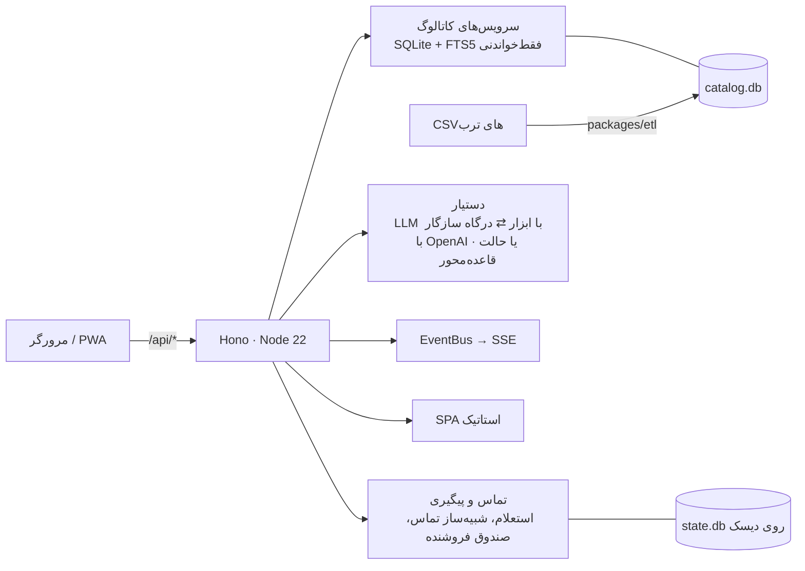

# Torob in the Loop

**دستیار هوشمند خرید حضوری در تهران** — پیدا کنید چه بخرید، کدام فروشگاه یا پاساژ آن را دارد، فروشگاه‌ها را مقایسه کنید و قبل از رفتن، قیمت و موجودی را از خود فروشنده بپرسید.
ساخته‌شده برای چالش ترب توسط تیم **Human in the Loop**، بر پایهٔ دیتاست ترب (فروشگاه‌ها، محصولات و پیشنهادهای
فروشگاه‌های حضوری تهران). فارسی، راست‌به‌چپ و موبایل‌محور.

- **نسخهٔ آنلاین:** <https://torob-in-the-loop.liara.run>
- **معرفی و آموزش تصویری:** [`docs/onboarding.html`](docs/onboarding.html) را در مرورگر باز کنید (ویژگی‌ها، راهنمای
  کاربر، نمودار داده‌ها، منبع داده‌ها و سناریوی دمو).
- **مستندات:
  ** [نیازمندی‌های محصول](docs/PRD.md) · [معماری](docs/ARCHITECTURE.md) · [طراحی دستیار و پیگیری](docs/AGENT-DESIGN.md) · [بازبینی طراحی](docs/DESIGN-REVIEW.md) · [گزارش داده](docs/DATA-REPORT.md) · [استقرار](docs/DEPLOY.md)

## چهار گام خرید و مشکلاتی که حل می‌کنیم

| گام / مشکل                            | قابلیت Torob in the Loop                                                                                                         |
|---------------------------------------|----------------------------------------------------------------------------------------------------------------------------------|
| ۱. نمی‌دانم چه مدلی بخرم              | «کمکم کن انتخاب کنم»: پرسش‌های کوتاه داده‌محور (بودجه، برند، کاربری)، مقایسهٔ محصولات و پیشنهاد مدل با «چرا»                     |
| ۲. کدام فروشگاه‌ها این کالا را دارند؟ | فروشگاه‌ها بر اساس موقعیت شما، محله‌ها و خوشه‌های پاساژی نزدیک؛ جداکردن «کالا را دارد» از «فقط دستهٔ فعالیتش مرتبط است»          |
| ۳. مقایسهٔ فروشگاه‌ها                 | قیمت، فاصله و زمان رسیدن، باز بودن در لحظهٔ رسیدن، تازگی قیمت، گارانتی و روش‌های پرداخت                                          |
| ۴. تماس با فروشگاه                    | استعلام موجودی، قیمت امروز، ساعت کاری و نگه‌داشتن کالا با تماس هوشمند (در دمو شبیه‌سازی‌شده)، پیگیری خودکار و صندوق پاسخ فروشنده |
| قیمت ثبت‌شده قدیمی است                | تاریخ و سن قیمت کنار هر قیمت؛ قیمت ثبت‌شده ≠ قیمت تأییدشده ≠ موجودی                                                              |
| فروشنده جواب نمی‌دهد / مغازه بسته است | تماس مجدد خودکار، تماس در ساعت باز شدن، و پیشنهاد فوری جایگزین (اول در همان پاساژ)                                               |
| پاساژ را پیدا کردم ولی مغازه را نه    | راهنمای داخل پاساژ (طبقه، واحد، راهرو، نشانه) از متن آدرس و فهرست طبقه‌به‌طبقهٔ ۴۴۸ پاساژ                                        |
| فقط خرید قسطی می‌خواهم                | گروه‌بندی فروشگاه‌ها بر اساس خدمات اعتباری ثبت‌شده (ترب‌پی، اسنپ‌پی، دیجی‌پی، تارا، ازکی‌وام) همراه با نوع اطلاعات               |
| اطلاعات ناموجود                       | به‌صراحت «نامشخص / ثبت نشده» نمایش داده می‌شود، همراه با گزینهٔ «از فروشگاه بپرسید»                                              |

ویژگی‌های دیگر: برنامهٔ بازدید با ترتیب بهینه و هشدار ساعت کاری، دکمه‌های «بسته بود / پیدایش نکردم / موجود نداشت /
گران‌تر بود» در محل، توجه به طرح ترافیک و نزدیک‌ترین ایستگاه مترو، ورودی صوتی، PWA قابل‌استفاده به‌صورت آفلاین.

## معماری



یک کانتینر، بدون وابستگی بومی (`node:sqlite`)، سرور باندل‌شده بدون `node_modules` در زمان اجرا. LLM اختیاری است و فقط
کیفیت گفتگو را بالا می‌برد؛ همهٔ اعداد از ابزارها و کاتالوگ می‌آیند و جمله‌ای که عدد ساختگی داشته باشد حذف می‌شود.

## طراحی رابط کاربری

رابط کاربری با مهارت [UI UX Pro Max](https://github.com/nextlevelbuilder/ui-ux-pro-max-skill) طراحی شده است (پوشهٔ
`.claude/skills/ui-ux-pro-max`). سیستم طراحی در [
`design-system/torob-in-the-loop/MASTER.md`](design-system/torob-in-the-loop/MASTER.md) و قواعد هر صفحه در
`design-system/torob-in-the-loop/pages/` است: پالت تجارت الکترونیک (سبز زمردی و نارنجی)، فونت وزیرمتن، کنتراست حداقل
۴٫۵:۱ و اهداف لمسی حداقل ۴۴ پیکسل.

## فناوری‌ها

Node 22 · TypeScript 5.9 · Hono 4 · zod · node:sqlite (FTS5) · esbuild · Vite 7 · React 19 · React Router 7 · TanStack
Query 5 · Zustand · Tailwind CSS 4 · Leaflet · Vitest · Docker · Liara · GitHub Actions

## شروع سریع

```bash
npm install
npm run data:build   # ساخت data/catalog.db از ../dataset (حدود ۴۰ ثانیه)
npm run dev          # سرور + وب در حالت توسعه (http://localhost:5173)
```

دیتاست خام ترب در مخزن نیست؛ مسیر آن را با `DATASET_DIR` تعیین کنید (پیش‌فرض: `../dataset`).

| اسکریپت                          | کار                                                                                      |
|----------------------------------|------------------------------------------------------------------------------------------|
| `npm run dev`                    | اجرای سرور و وب با بارگذاری مجدد                                                         |
| `npm run build`                  | build وب (Vite) و سرور (esbuild)                                                         |
| `npm start`                      | اجرای نسخهٔ build‌شده                                                                    |
| `npm run data:build`             | ساخت کاتالوگ از CSVها                                                                    |
| `npm run data:fixtures`          | نمونه‌برداری دادهٔ کوچک واقعی برای تست (نیاز به دیتاست خام)                              |
| `npm run data:fixture-db`        | ساخت `data/fixture.db` از CSVهای نمونهٔ داخل مخزن (پیش از `npm test` خودکار اجرا می‌شود) |
| `npm run typecheck` / `npm test` | بررسی نوع و ۲۳۱ تست (Vitest)                                                             |
| `scripts/smoke.sh <url>`         | تست دود نُه‌مرحله‌ای روی نسخهٔ در حال اجرا                                               |
| `scripts/check-size.sh`          | اندازهٔ آپلود لیارا                                                                      |
| `scripts/deploy-liara.sh`        | استقرار روی لیارا (`--team-id` برای اپ تیمی)                                             |

**متغیرهای محیطی:** همه در [`.env.example`](.env.example) با توضیح فارسی و انگلیسی آمده‌اند. دستیار با هر درگاه سازگار
با OpenAI کار می‌کند (مثلاً BoxAPI با `LLM_BASE_URL=https://ai.boxapi.ir/ai/v1` و `LLM_MODEL=openai/gpt-5.4-mini`، یا
Liara AI). بدون `LLM_BASE_URL` و `LLM_API_KEY` دستیار در حالت قاعده‌محور فارسی کار می‌کند.

## استقرار

راهنمای کامل در [docs/DEPLOY.md](docs/DEPLOY.md). خلاصه:

- **لیارا (Docker):** اپ `torob-in-the-loop` با دیسک پایدار در `/var/lib/torob-in-the-loop` برای state؛
  `scripts/deploy-liara.sh` خروجی‌های آماده را با `Dockerfile.runtime` منتشر می‌کند.
- **GitHub Actions:** هر push روی `main` تایپ‌چک، تست و build می‌کند و در صورت تنظیم secretها (`LIARA_API_TOKEN`،
  `LIARA_TEAM_ID`، `CATALOG_URL`) کاتالوگ را از Release دانلود، روی لیارا مستقر و تست دود اجرا می‌کند. فایل
  `data/catalog.db.gz` (حدود ۱۱۴ مگابایت) باید یک بار به‌عنوان Release asset بارگذاری شود.

## نکته‌های دیتاست

- نام بیشتر فروشگاه‌ها و **همهٔ شماره‌تلفن‌ها ساختگی‌اند**؛ بنابراین تماس‌ها در حالت دمو (`DEMO_MODE=true`) شبیه‌سازی
  می‌شوند، همیشه برچسب «نسخهٔ نمایشی» دارند و فروشنده‌ها می‌توانند از صفحهٔ `/seller` پاسخ دهند.
- قیمت‌ها به تومان‌اند؛ قیمت صفر یعنی «ثبت نشده» و قیمت‌های غیرعادی علامت‌گذاری و از آمار حذف می‌شوند. سن قیمت نسبت به
  تاریخ اسنپ‌شات دیتاست (۲۱ مهر ۱۴۰۵) سنجیده می‌شود.
- داده‌ای برای کالابرگ وجود ندارد و همیشه «ثبت نشده» نمایش داده می‌شود.
- دادهٔ بیرونی: ایستگاه‌ها و خطوط مترو از © OpenStreetMap contributors؛ مترادف‌ها، برندها، گروه‌بندی دسته‌ها و مکان‌های
  تهران (با مختصات تقریبی) در `packages/etl/data/` با توضیح روش ساخت.
- جزئیات بیشتر: [docs/DATA-REPORT.md](docs/DATA-REPORT.md) و بخش «منبع داده‌ها» در `docs/onboarding.html`.

## ساختار پروژه

```
packages/shared/   قرارداد مشترک: نوع‌های API، نرمال‌سازی فارسی، قالب‌بندی، زمان تهران
packages/etl/      ساخت کاتالوگ از CSVها، دادهٔ گردآوری‌شده و CSVهای نمونه برای تست
apps/server/       API (Hono)، سرویس‌های کاتالوگ، دستیار، تماس و پیگیری
apps/web/          اپ وب (React، RTL، موبایل‌محور، PWA)
design-system/     سیستم طراحی تولیدشده با UI UX Pro Max
scripts/           استقرار، تست دود، اندازهٔ آپلود، entrypoint و healthcheck کانتینر
docs/              PRD، معماری، طراحی دستیار، بازبینی طراحی، داده، استقرار، صفحهٔ معرفی
Dockerfile         build کامل از سورس   ·   Dockerfile.runtime  ایمیج سریع از خروجی‌های آماده (لیارا)
```

## تست

`npm run typecheck` و `npm test` (۲۳۱ تست Vitest در همهٔ workspaceها؛ `fixture.db` خودکار از CSVهای نمونه ساخته می‌شود)
و پس از استقرار `scripts/smoke.sh <url>`.

---

## English summary

**Torob in the Loop** is a Persian, RTL, mobile-first assistant for **in-person shopping in Tehran**, built by team *
*Human in the Loop** for the Torob challenge on Torob's dataset. Live: <https://torob-in-the-loop.liara.run> · Visual
intro & onboarding: `docs/onboarding.html`.

It covers the four steps from the brief: **decide what to buy** (guided data-driven questions, product comparison), *
*find stores** (location-aware, nearby areas/passage clusters, offer vs. category-only), **compare stores** (price,
distance, hours at arrival time, price freshness, payment options) and **contact stores** (AI-call inquiries, simulated
in demo mode, with automatic retries, a seller inbox and follow-up). Pain points get dedicated features: stale prices
are labeled with their age, closed/unresponsive shops trigger alternatives, in-passage wayfinding is parsed from
addresses, installment providers are grouped with their information type, and unknown data is always shown as unknown.

- **Architecture:** one Node 22 container — Hono API + static SPA, read-only SQLite/FTS5 catalog (built by
  `packages/etl`), mutable state DB on a persistent disk, SSE for live events and chat, optional OpenAI-compatible LLM (
  e.g. BoxAPI, Liara AI) with a rule-based Persian fallback.
- **Design:** UI built with the UI UX Pro Max skill; design system in `design-system/torob-in-the-loop/`.
- **Quick start:** `npm install && npm run data:build && npm run dev`.
- **Config:** `.env.example`. **Deploy:** `docs/DEPLOY.md` (Liara Docker app, `scripts/deploy-liara.sh`, GitHub Actions
  with `LIARA_API_TOKEN` / `LIARA_TEAM_ID` / `CATALOG_URL` secrets, `scripts/smoke.sh`).
- **Dataset notes:** shop names are mostly and phone numbers entirely fake, so calls are simulated and labeled; prices
  are in Toman; no Kalabarg data exists; metro data © OpenStreetMap contributors.
- **Testing:** `npm run typecheck`, `npm test` (231 tests), `scripts/smoke.sh <url>`.
