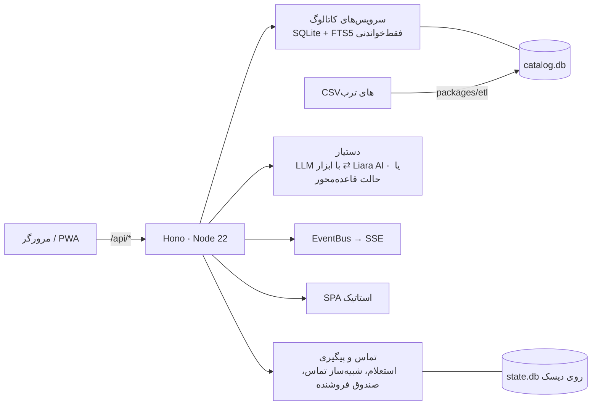

# Torob in the Loop (Torob in the Loop)

**دستیار هوشمند خرید حضوری در تهران** — پیدا کنید چه بخرید، کدام فروشگاه یا پاساژ آن را دارد، فروشگاه‌ها را مقایسه کنید و قبل از رفتن، قیمت و موجودی را از خود فروشنده بپرسید.
ساخته‌شده برای هکاتون ترب، بر پایهٔ دیتاست ترب (فروشگاه‌ها، محصولات و پیشنهادهای فروشگاه‌های حضوری تهران). فارسی، راست‌به‌چپ و موبایل‌محور.

> مستندات: [نیازمندی‌های محصول](docs/PRD.md) · [معماری](docs/ARCHITECTURE.md) · [گزارش داده](docs/DATA-REPORT.md) · [استقرار](docs/DEPLOY.md)

## چهار گام خرید و مشکلاتی که حل می‌کنیم

| گام / مشکل | قابلیت Torob in the Loop |
|---|---|
| ۱. نمی‌دانم چه مدلی بخرم | پرسش‌های کوتاه راهنما، مقایسهٔ محصولات و قیمت‌ها، پیشنهاد مدل با «چرا» |
| ۲. کدام فروشگاه‌ها این کالا را دارند؟ | فهرست فروشگاه‌ها بر اساس موقعیت شما، پیشنهاد محله‌ها و پاساژهای نزدیک؛ جداکردن «کالا را دارد» از «فقط دستهٔ فعالیتش مرتبط است» |
| ۳. مقایسهٔ فروشگاه‌ها | قیمت، فاصله، ساعت کاری در زمان مراجعه، تازگی قیمت، روش‌های پرداخت |
| ۴. تماس با فروشگاه | استعلام موجودی، قیمت به‌روز، ساعت کاری و رزرو با تماس هوشمند (در دمو شبیه‌سازی‌شده) و پیگیری خودکار |
| قیمت ثبت‌شده قدیمی است | نمایش تاریخ تغییر قیمت؛ قیمت ثبت‌شده ≠ قیمت تأییدشده ≠ موجودی |
| فروشنده جواب نمی‌دهد / مغازه بسته است | پیشنهاد فوری جایگزین‌ها |
| پاساژ را پیدا کردم ولی مغازه را نه | راهنمای داخل پاساژ (طبقه، واحد، راهرو، نشانه) از متن آدرس |
| فقط خرید قسطی می‌خواهم | فیلتر فروشگاه‌های دارای خدمات اعتباری، همراه با نوع اطلاعات |
| اطلاعات ناموجود | به‌صراحت «نامشخص / ثبت نشده» نمایش داده می‌شود، همراه با گزینهٔ «از فروشگاه بپرسید» |

## تصاویر

| خانه | نتایج جستجو | فروشگاه‌ها | دستیار |
|---|---|---|---|
|  |  |  |  |

## معماری



یک کانتینر، بدون وابستگی بومی (`node:sqlite`)، سرور باندل‌شده بدون `node_modules` در زمان اجرا. LLM اختیاری است و فقط کیفیت گفتگو را بالا می‌برد؛ همهٔ داده‌ها از ابزارها و کاتالوگ می‌آیند.

## فناوری‌ها

Node 22 · TypeScript 5.9 · Hono 4 · zod · node:sqlite (FTS5) · esbuild · Vite 7 · React 19 · React Router 7 · TanStack Query 5 · Zustand · Tailwind CSS 4 · Leaflet · Vitest · Playwright · Docker · Liara

## شروع سریع

```bash
npm install
npm run data:build   # ساخت data/catalog.db از ../dataset (چند دقیقه)
npm run dev          # سرور + وب در حالت توسعه
```

| اسکریپت | کار |
|---|---|
| `npm run dev` | اجرای سرور و وب با بارگذاری مجدد |
| `npm run build` | build وب (Vite) و سرور (esbuild) |
| `npm start` | اجرای نسخهٔ build‌شده |
| `npm run data:build` | ساخت کاتالوگ از CSVها |
| `npm run data:fixtures` | دادهٔ نمونهٔ کوچک برای تست |
| `npm run typecheck` / `npm test` | بررسی نوع و تست‌ها (Vitest) |
| `npm run e2e` | تست‌های سرتاسری (Playwright) |
| `scripts/smoke.sh <url>` | تست دود روی نسخهٔ در حال اجرا |
| `scripts/check-size.sh` | اندازهٔ آپلود لیارا |
| `scripts/deploy-liara.sh` | استقرار روی لیارا |

**متغیرهای محیطی:** همه در [`.env.example`](.env.example) با توضیح فارسی و انگلیسی آمده‌اند. بدون `LLM_BASE_URL` و `LLM_API_KEY` دستیار در حالت قاعده‌محور کار می‌کند.

**استقرار:** راهنمای کامل در [docs/DEPLOY.md](docs/DEPLOY.md).

## نکته‌های دیتاست

- نام بیشتر فروشگاه‌ها و **همهٔ شماره‌تلفن‌ها ساختگی‌اند**؛ بنابراین تماس‌ها در حالت دمو (`DEMO_MODE=true`) شبیه‌سازی می‌شوند و فروشنده‌ها می‌توانند از صفحهٔ `/seller` پاسخ دهند.
- قیمت‌ها به تومان‌اند؛ قیمت صفر یعنی «ثبت نشده» و قیمت‌های غیرعادی علامت‌گذاری می‌شوند.
- داده‌ای برای کالابرگ وجود ندارد و همیشه «ثبت نشده» نمایش داده می‌شود.
- جزئیات بیشتر: [docs/DATA-REPORT.md](docs/DATA-REPORT.md).

## ساختار پروژه

```
packages/shared/   قرارداد مشترک: نوع‌های API، نرمال‌سازی فارسی، قالب‌بندی، زمان تهران
packages/etl/      ساخت کاتالوگ از CSVها
apps/server/       API (Hono)، سرویس‌ها، دستیار، تماس و پیگیری
apps/web/          اپ وب (React، RTL، موبایل‌محور)
scripts/           استقرار، تست دود، اندازهٔ آپلود، entrypoint و healthcheck کانتینر
docs/              PRD، معماری، داده، استقرار
Dockerfile         build کامل از سورس   ·   Dockerfile.runtime  ایمیج سریع از خروجی‌های آماده (لیارا)
```

## تست

`npm test` (Vitest در همهٔ workspaceها)، `npm run typecheck`، `npm run e2e` و پس از استقرار `scripts/smoke.sh`.

---

## English summary

**Torob in the Loop** is a Persian, RTL, mobile-first assistant for **in-person shopping in Tehran**, built for the Torob hackathon on Torob's dataset. It covers the four steps from the brief: **decide what to buy** (guided questions, product comparison), **find stores** (location-aware, nearby areas/passages, offer vs. category-only), **compare stores** (price, distance, hours at visit time, price freshness, payment options) and **contact stores** (AI-call inquiries, simulated in demo mode, with automatic follow-up). Pain points get dedicated features: stale prices are labeled with dates, closed/unresponsive shops trigger alternatives, in-passage wayfinding is parsed from addresses, installment-only filtering, and unknown data is always shown as unknown.

- **Architecture:** one Node 22 container: Hono API + static SPA, read-only SQLite/FTS5 catalog (built by `packages/etl`), mutable state DB on a persistent disk, SSE for live events and chat, optional OpenAI-compatible LLM (Liara AI) with a rule-based fallback.
- **Quick start:** `npm install && npm run data:build && npm run dev`.
- **Config:** see `.env.example`. **Deploy:** see `docs/DEPLOY.md` (Liara, Docker platform, `scripts/deploy-liara.sh`, `scripts/smoke.sh`).
- **Dataset notes:** shop names are mostly and phone numbers entirely fake, so calls are simulated; prices are in Toman; no Kalabarg data exists.
- **Testing:** `npm run typecheck`, `npm test`, `npm run e2e`, `scripts/smoke.sh <url>`.
